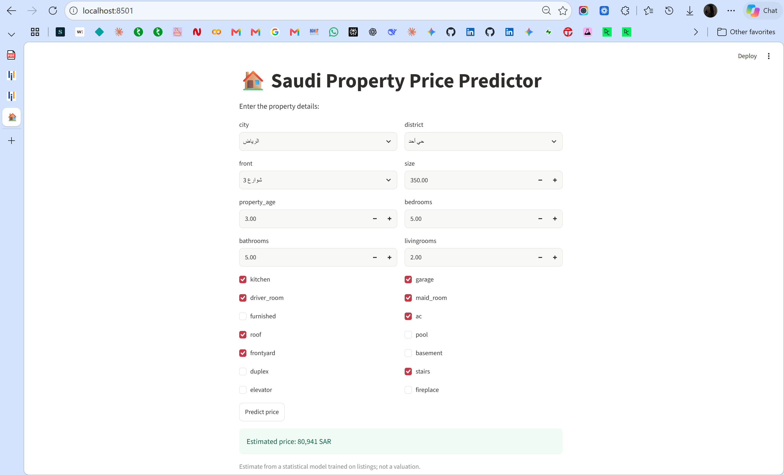
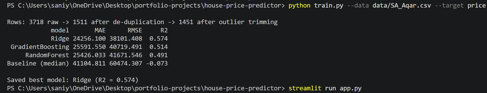

# Saudi Property Price Predictor

An end-to-end machine learning project: clean real listing data, compare models against a baseline, save the best one, and serve predictions in a web app.

## Dataset
SA Aqar listings (Kaggle): 3,718 property listings from Riyadh, Jeddah, Dammam and Khobar, with 174 districts and features such as size, property age, rooms, and amenities (garage, pool, elevator and more). The listing text indicates these are rental listings, so `price` is the advertised rent (SAR).

Place the file at `data/SA_Aqar.csv`.

## Data cleaning
| Step | Rows remaining |
|---|---|
| Raw listings | 3,718 |
| After removing exact duplicate listings | 1,511 |
| After trimming extreme `price` and `size` values (1st to 99th percentile) | 1,451 |

- **Duplicates matter:** 59% of rows were exact duplicates. Left in, the same listing would appear in both training and test sets and inflate the scores.
- The free-text `details` column was dropped (it contains Arabic descriptions and phone numbers).
- Price is modelled on a log scale, because rents are right-skewed. Metrics are reported in SAR.

## Pipeline
- Missing values: median (numeric), most frequent (categorical)
- Scaling and one-hot encoding in a single scikit-learn `ColumnTransformer`
- Models compared: Ridge, Random Forest, Gradient Boosting, plus a "predict the median" baseline
- Metrics: MAE, RMSE, R2 on a held-out 20% test set

## Results




| model | MAE (SAR) | RMSE (SAR) | R2 |
|---|---|---|---|
| Ridge | 24,256 | 38,101 | 0.574 |
| GradientBoosting | 25,592 | 40,719 | 0.514 |
| RandomForest | 25,426 | 41,672 | 0.491 |
| Baseline (median) | 41,105 | 60,474 | -0.073 |

Ridge performed best: it explains about 57% of the variation in price and cuts the typical error from about 41,000 SAR (the baseline) to about 24,000 SAR. The tree-based models did not beat the linear model, likely because the cleaned dataset is small (about 1,450 rows) and the listings lack information that strongly drives rent, such as exact location and condition.

## Run it
```bash
pip install -r requirements.txt
python train.py --data data/SA_Aqar.csv --target price
streamlit run app.py
```

## Limitations and next steps
- Small dataset after de-duplication; results will vary with a different train/test split.
- Add an EDA notebook (price by city and district, correlations)
- Feature importance or SHAP plot to show what drives rent
- Hyperparameter tuning with GridSearchCV and cross-validation
- Try features from the Arabic `details` text
- Deploy on Streamlit Community Cloud or Hugging Face Spaces

## Tech
Python, pandas, scikit-learn, Streamlit
